<!-- Repo must be named exactly: hnourouzi/hnourouzi (public). Replace every YOUR-... placeholder. -->

 

## About

 

<i>"Boundaries first, framework second."</i>

## Stack

## GitHub Insights

<!-- Productive time uses UTC by default. To match his timezone add &utcOffset=<hours> to that card's URL (e.g. 3.5) -->

### Contribution Snake

## Projects

### 🚛 Towing & Transportation Platform

A multi-tenant platform for towing and transportation companies: job assignment, driver management, status tracking and RESTful APIs.

**Tech Stack:** Laravel · Multi-tenancy · REST API

---

### 👜 Nafis Leather & Mashhad Leather

API-driven e-commerce for two leather brands, one integrated with inventory software and physical stores to connect online sales with in-store operations.

**Tech Stack:** Laravel · REST API · Third-party integrations

---

### 💱 Mehr Exchange

A currency-exchange website with order placement, currency exchange and order matching.

**Tech Stack:** PHP · Fintech · Order matching

---

### 🛡️ Firewall License Management

A license-management website for firewall products, with control classes and an OPNsense module for managing software licenses.

**Tech Stack:** PHP · OPNsense · Licensing

---

### 🧩 ERP & Employee Attendance

An ERP product for managing and controlling internal processes, plus an application for tracking attendance and working time.

**Tech Stack:** PHP · Laravel · Process management

> More on the [portfolio](https://hnourouzi.github.io).

## Connect

